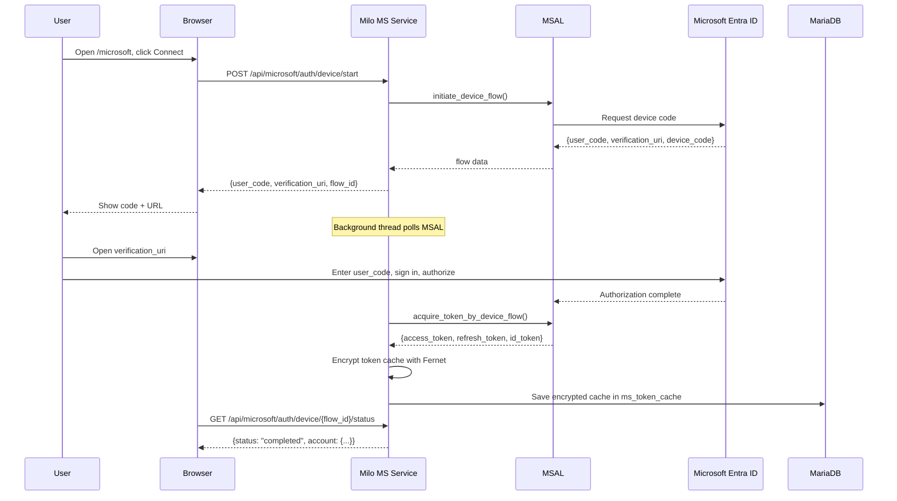
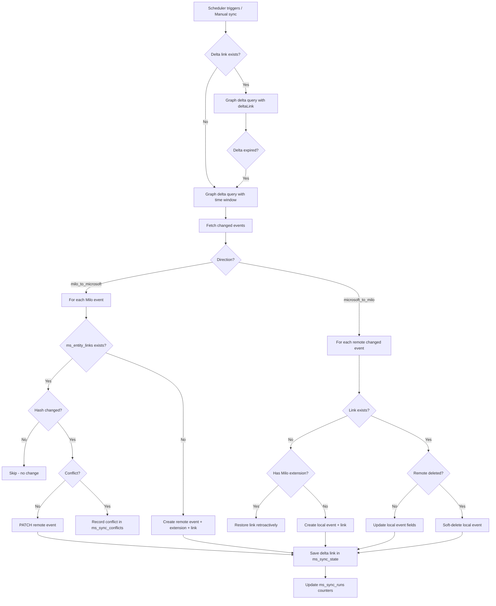
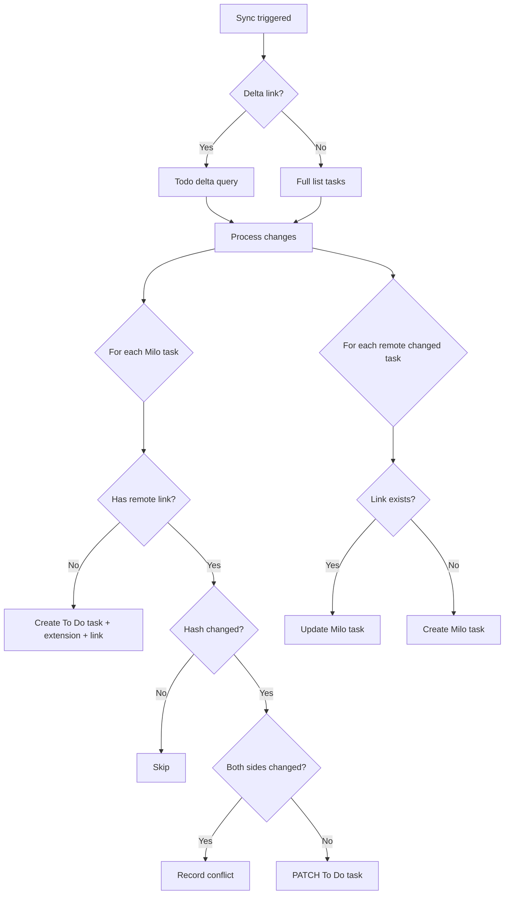
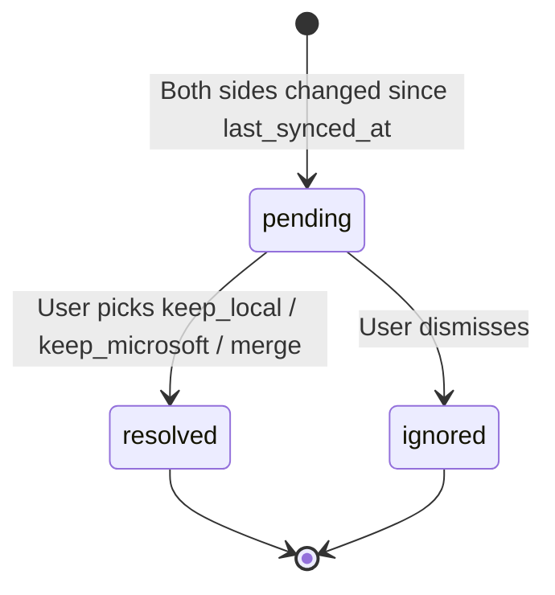
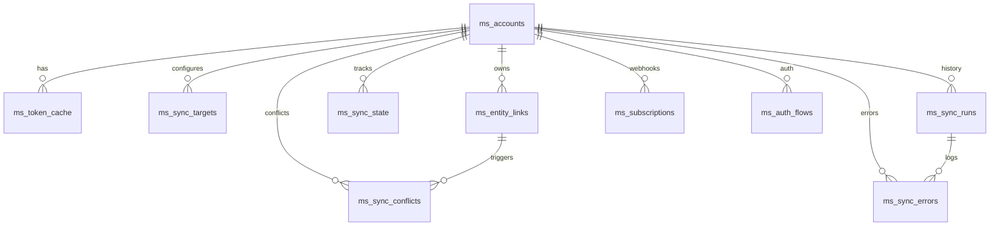

# Microsoft Integration — Architecture

## Service Topology

```
┌──────────────────────────────────────────────────────────┐
│                       Milo User                          │
│                                                          │
│   Browser → http://localhost:8000   (Milo main)          │
│   Browser → http://localhost:8010   (MS integration)     │
└──────────────────────────────────────────────────────────┘
             │                              │
             ▼                              ▼
    ┌─────────────────┐         ┌─────────────────────────┐
    │  Milo FastAPI   │         │  Microsoft Integration  │
    │  (port 8000)    │         │  FastAPI (port 8010)    │
    │                 │         │                         │
    │  notes/tasks/   │         │  Auth, Graph, Sync,     │
    │  events tables  │         │  Scheduler, Webhooks    │
    └────────┬────────┘         └───────────┬─────────────┘
             │                              │
             └──────────┐   ┌──────────────┘
                        ▼   ▼
                   ┌──────────────┐
                   │   MariaDB    │
                   │  Database    │
                   │              │
                   │  notes       │ ← Milo tables
                   │  tags        │
                   │  ...         │
                   │              │
                   │  ms_accounts │ ← Microsoft tables
                   │  ms_entity_  │
                   │    links     │
                   │  ms_sync_    │
                   │    runs      │
                   │  ...         │
                   └──────────────┘
```

## Authentication Flow (Device Code)



## Calendar Sync Flow



## To Do Sync Flow



## Conflict Resolution Flow



## Database Schema



## Directory Structure

```
microsoft_integration/
├── main.py              ← FastAPI app factory + startup/shutdown
├── config.py            ← Pydantic settings from env
├── database.py          ← SQLAlchemy engine + session factory
├── models.py            ← SQLAlchemy ORM for all ms_* tables
├── schemas.py           ← Pydantic DTOs for API and sync engine
├── logging_config.py    ← Structured logging setup
│
├── auth/                ← Authentication layer
│   ├── encryption.py    ← Fernet encryption/decryption
│   ├── token_cache.py   ← Persisted MSAL token cache
│   ├── msal_client.py   ← MSAL PublicClientApplication factory
│   └── device_flow.py   ← Device Code Flow manager + background poll
│
├── graph/               ← Microsoft Graph API v1.0 client
│   ├── client.py        ← Core HTTP client (retry, headers, delta)
│   ├── errors.py        ← GraphError hierarchy
│   ├── retry.py         ← 429/5xx retry with exponential backoff
│   ├── pagination.py    ← @odata.nextLink pagination helpers
│   ├── calendar.py      ← Calendar and event operations
│   ├── todo.py          ← To Do list and task operations
│   ├── profile.py       ← User profile
│   └── extensions.py    ← Open Extensions (com.milo.sync)
│
├── sync/                ← Bidirectional sync engine
│   ├── engine.py        ← Orchestrator: runs sync for account(s)
│   ├── calendar_sync.py ← Calendar ↔ Milo event sync
│   ├── todo_sync.py     ← To Do ↔ Milo task sync
│   ├── conflict_resolver.py ← Conflict detection and recording
│   ├── mapping.py       ← DTO ↔ Graph payload field mapping
│   ├── local_repository.py  ← Milo DB adapter (raw SQL, no ORM dependency)
│   ├── remote_repository.py ← Graph responses → DTOs
│   ├── scheduler.py     ← APScheduler async job
│   └── locks.py         ← MariaDB advisory locks
│
├── api/                 ← FastAPI routes
│   ├── auth_routes.py
│   ├── account_routes.py
│   ├── sync_routes.py
│   ├── config_routes.py
│   ├── conflict_routes.py
│   ├── webhook_routes.py
│   └── health_routes.py
│
├── ui/                  ← Independent UI (no Milo CSS/JS)
│   ├── templates/       ← Jinja2 HTML templates
│   └── static/          ← CSS, JavaScript
│
├── sql/                 ← SQL migration files
│   └── 001_microsoft_schema.sql
│
├── scripts/             ← Operational scripts
├── tests/               ← All Microsoft tests (never modify Milo tests)
└── docs/                ← Documentation
```

## Key Design Decisions

### 1. No modification of Milo files
The integration lives entirely under `microsoft_integration/`. The only shared resource is the MariaDB database (via `ms_*` tables).

### 2. Milo as source of truth
Milo's data model is authoritative. Microsoft is an integration target. Microsoft-specific fields that don't map to Milo (e.g., Graph-only metadata) are not stored in Milo.

### 3. Adapter pattern for Milo data access
`sync/local_repository.py` is the single point of contact with Milo tables. It uses raw SQL (never Milo's ORM) and returns DTOs, decoupling the sync engine from Milo schema changes.

### 4. Idempotency via sync hashes
A SHA-256 hash of syncable fields is stored in `ms_entity_links.sync_hash`. Sync only writes to Microsoft if the local hash has changed since last sync.

### 5. Delta-first approach
After the first full sync, subsequent syncs use `@odata.deltaLink` to fetch only changed items. Delta tokens expire after ~30 days of inactivity; the service handles this gracefully with automatic full-sync fallback.

### 6. Conflict safety
When both sides change since the last `last_synced_at`, a conflict is recorded and surfaced in the UI. The default policy is `manual` — no data is overwritten without user intervention.
